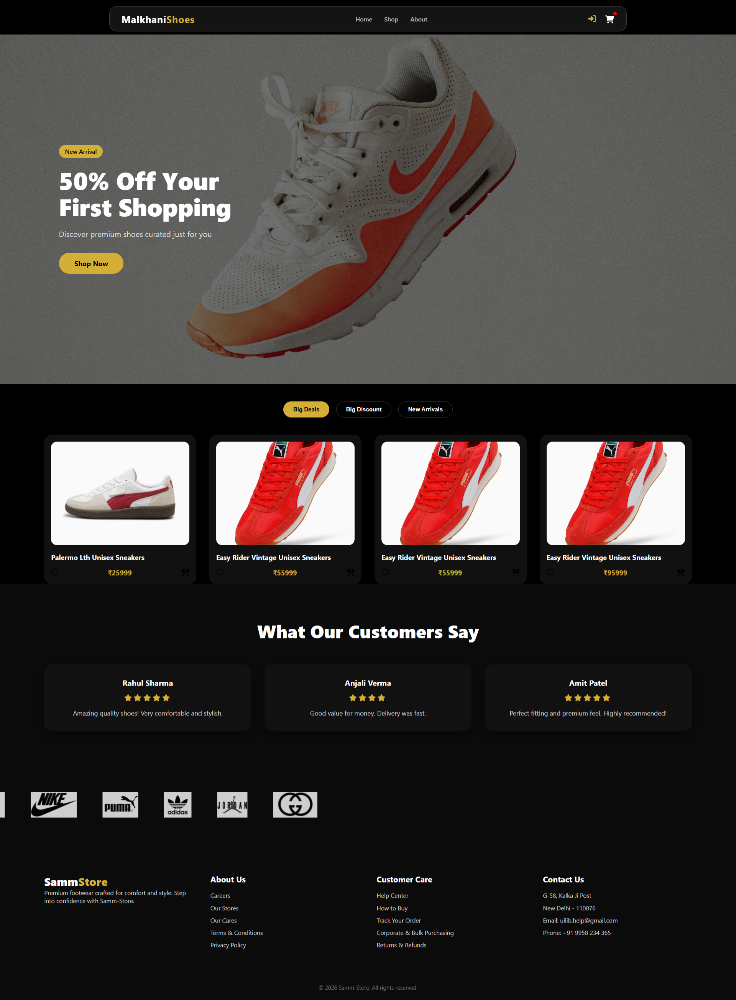
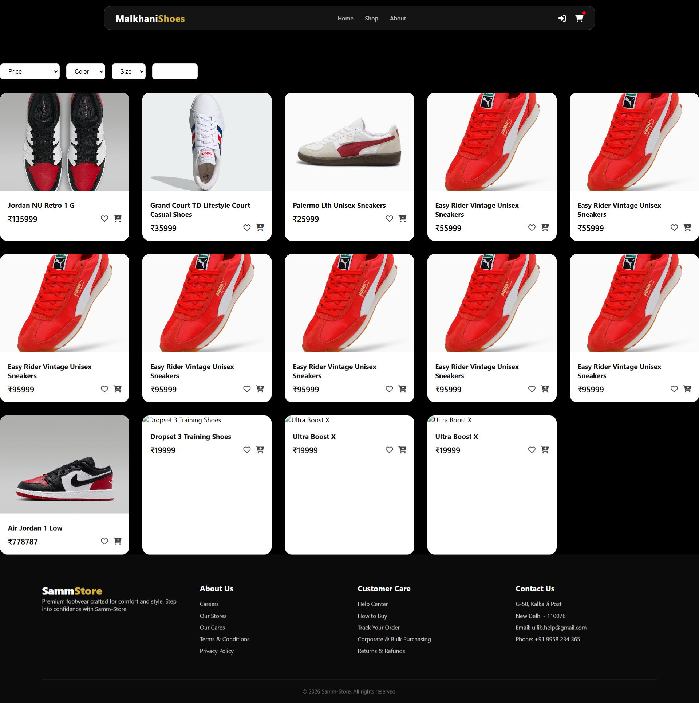
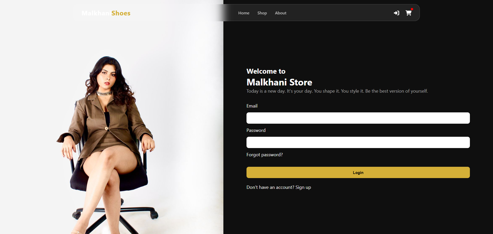
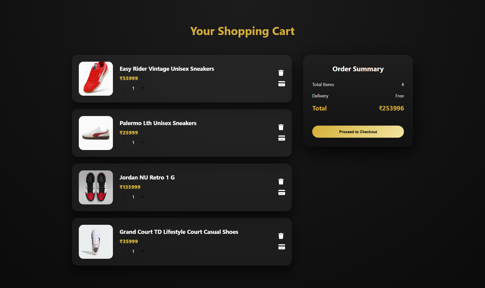
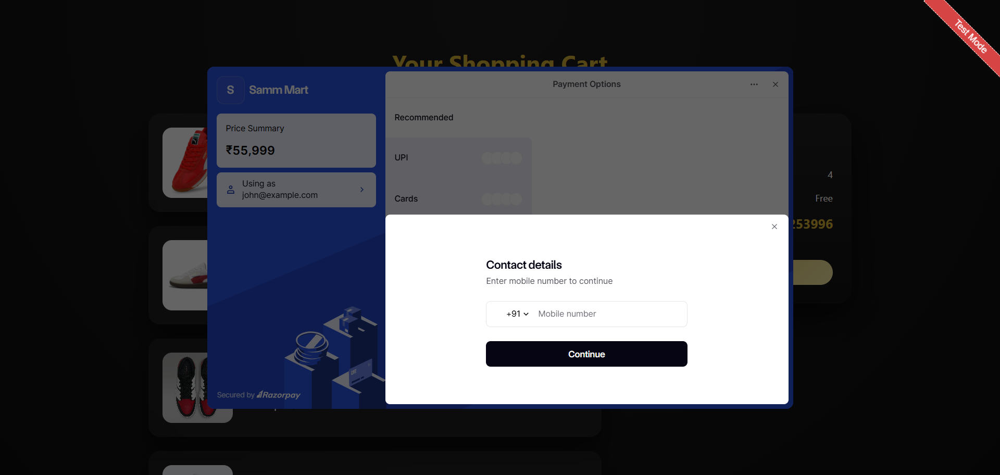

# 👟 Shoe Store Web Application (MERN Stack)

A full-stack e-commerce Shoe Store application built using the MERN stack.
Users can browse shoes, view product details, manage their profile, and purchase items.
The application also includes an **Admin Panel** to manage products and users.

---

## 🚀 Features

### 👤 User Features

* Browse all shoes
* View product details
* Add products to cart
* User authentication (Login / Register)
* Manage user profile
* Responsive design

### 🛠 Admin Panel

* Add new products
* Edit products
* Delete products
* Manage users
* View all orders
* Admin dashboard

---

## 🛠 Tech Stack

### Frontend

* React.js
* Redux Toolkit
* CSS / Bootstrap

### Backend

* Node.js
* Express.js

### Database

* MongoDB

---

## 📸 Screenshots

### Home Page

### Shop Page 

### Product Detail

### User Login

### Cart

### Payment

---

## 📂 Project Structure

frontend/ → React frontend application
backend/ → Node.js REST API
assets/ → Screenshots for README

---

## ⚙️ Installation

Clone the repository

git clone https://github.com/sammsidd7777/shoe-store.git

### Install Frontend

cd frontend
npm install
npm start

### Install Backend

cd backend
npm install
npm run dev

---

## 🔐 Admin Access

Admin users can:

* Manage all products
* Manage users
* Update or delete products
* Access admin dashboard

---

## 👨‍💻 Author

Samm
